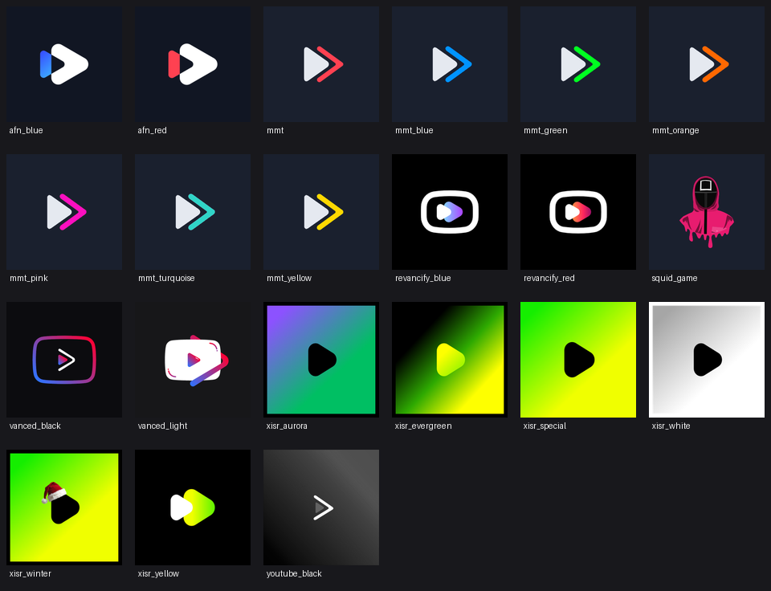
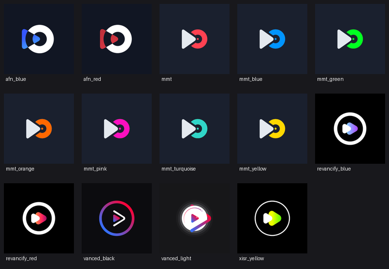

# Patches

Branding presets for YouTube and YT Music. Pick a logo pack, a button style,
patch, install. Works with Morphe Manager and Morphe Desktop.

  

## Included

Logo packs. 21 for YouTube and 14 for YT Music, including Vanced Light and
Vanced Black. The notification icon matches the pack, never stock.

Overlay buttons. Bold, Rounded and Thin player button styles for YouTube.

Shorts buttons. Cairo, Outline, Outline Circle, Round and YouTube Outline
styles for YouTube Shorts. Stock leaves the app untouched.

Custom art. Bring your own icon folder and header folder instead of a preset.
See the Custom icon and Custom header options inside each patch.

## Logo pack previews

Every preset below is selectable in the App icon option. Match the name,
then patch.

### YouTube

### YT Music

## Patches list

<!-- PATCHES_START EXPANDED -->
> **[v1.0.1](https://github.com/sahilwasgood/patches/releases/tag/v1.0.1)**&nbsp;&nbsp;•&nbsp;&nbsp;`main`&nbsp;&nbsp;•&nbsp;&nbsp;5 patches total

📦 XYZ app&nbsp;&nbsp;•&nbsp;&nbsp;1 patch

 

**🎯 Supported versions:**

| 2.0.0 | 1.0.2 |
| :---: | :---: |

| 💊&nbsp;Patch | 📜&nbsp;Description | ⚙️&nbsp;Options |
|----------|----------------|-----------|
| [Example Patch](#example-patch) | Example patch to start with. |  |

📦 YT Music&nbsp;&nbsp;•&nbsp;&nbsp;1 patch

 

| 💊&nbsp;Patch | 📜&nbsp;Description | ⚙️&nbsp;Options |
|----------|----------------|-----------|
| [Logo packs](#logo-packs) | Applies a preset app icon (all packs incl. Vanced Light). | • App icon • Custom icon |

📦 YouTube&nbsp;&nbsp;•&nbsp;&nbsp;3 patches

 

| 💊&nbsp;Patch | 📜&nbsp;Description | ⚙️&nbsp;Options |
|----------|----------------|-----------|
| [Logo packs](#logo-packs) | Applies a preset app icon (all packs incl. Vanced Light). Use Custom icon with a folder for your own art. | • App icon • Custom icon |
| [Overlay button style](#overlay-button-style) | Player overlay button style (Bold / Rounded / Thin). | • Button style |
| [Shorts button style](#shorts-button-style) | Shorts action button style. Stock leaves the app untouched. | • Button style |

<!-- PATCHES_END -->

## Build it yourself

Needs Java 21 and `./gradlew buildAndroid`. The bundle lands in
`patches/build/libs`. Details live in the
[Morphe documentation](https://github.com/MorpheApp/morphe-documentation).

## License

GPLv3. See [LICENSE](LICENSE).
